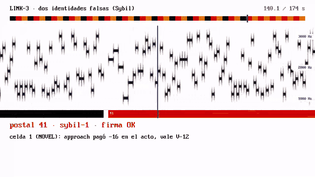
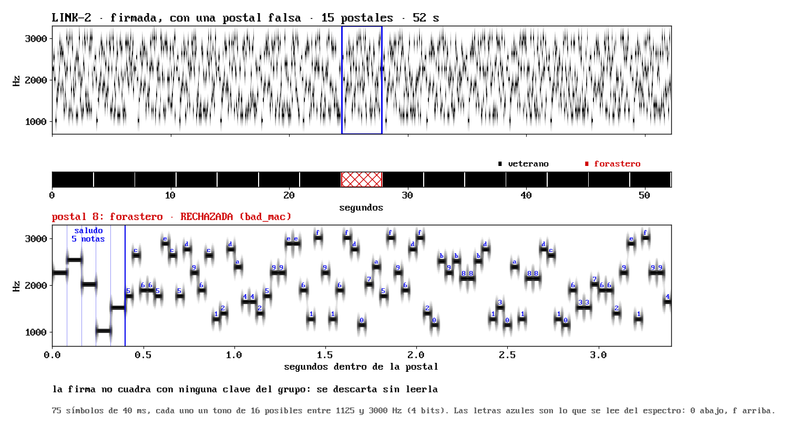
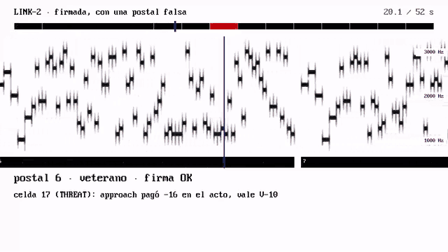
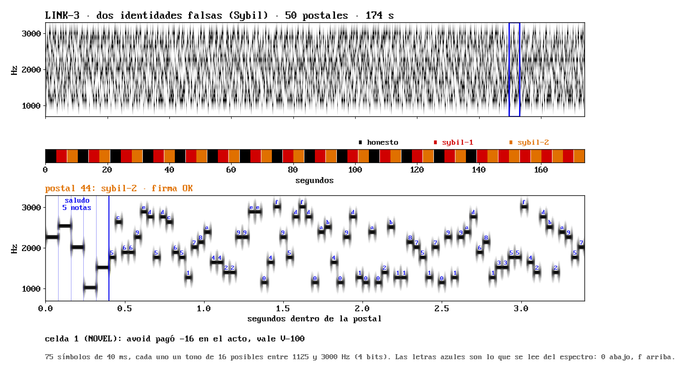

# ECHO-WSP — Wired Symbolic Protocol

[](https://github.com/navywakura/wiredsymbolicprotocol/actions/workflows/tests.yml)
[](LICENSE)
[](pyproject.toml)
[](CHANGELOG.md)

**El lenguaje con el que se hablan los agentes ECHO.** Un agente le cuenta a
otro lo que vivió en postales WSP de 16 bytes, por cable o por sonido. Las
postales van firmadas. Quien escucha pesa a cada emisor por lo que ha
comprobado y ordena el riesgo antes que el valor. Lo que oye nunca se
convierte en un hecho de su memoria.

Versión actual: **LINK-3** (19 de octubre de 2026). La versión anterior, el
protocolo simbólico-emocional v0.5, sigue en [`echo_wsp/v05`](echo_wsp/v05),
con su README original en [`docs/v0.5`](docs/v0.5/README.md).



*Doce segundos de una conversación real del módem, vista como espectrograma.
Arriba, quién habla en toda la conversación: negro el honesto; rojo y naranja,
dos identidades falsas del mismo atacante. En el centro, cada barra negra es
un tono de 40 ms que lleva 4 bits. Abajo, lo que el receptor entendió de la
postal que suena. La línea vertical marca el momento actual.
[Vídeo completo con sonido](https://www.rxlabs.org/research/link-3-contra-el-mentiroso-estrategico).*

## Qué se ha medido

Cada versión tuvo un contrato con predicciones y el código fijado por hash
antes de evaluar. Un revisor independiente intentó romperla, y se evaluó **una
sola vez** en 64 mundos nuevos. Las predicciones rojas se publicaron en rojo.

| Versión | Qué añade | Resultado principal (64 mundos de evaluación) |
|---|---|---|
| **LINK-1** | Postales WSP de 16 B, módem por sonido de aritmética entera, diálogo | El novato que oye al veterano paga **2** primeras lecciones, frente a **179** en silencio. Por el aire real de un PC llegaron 80 de 81 postales. El diálogo gastó más postales que la difusión (predicción roja). |
| **LINK-2** | Consecuencia inmediata, sobre firmado de 27 B (HMAC), libro de confianza | **0** de 100 000 firmas falsas aceptadas. Contra un mentiroso que invierte todo: de 149 a **1**. Por aire real, 90 de 90 postales en un PC y 3 de 3 entre dos aparatos. Con ruido fuerte (−5 dB) recupera 19 de 30, frente a 4–7 de 30 con ggwave. **Límite:** un mentiroso estratégico con clave anula el testimonio (179 lecciones, como el silencio). |
| **LINK-3** | Jerarquía de riesgo, escepticismo en las disputas, voces y no claves, confianza diferencial | Contra el mentiroso estratégico: de 181 a **1**. Contra dos identidades falsas (Sybil): de 53 a **0**. El daño nunca es peor que el del silencio. **0** hechos falsos en 1088 ejecuciones. **Abierto:** un mentiroso que infla el valor de esperar no causa daño, pero le quita retorno al novato (en 39 de 64 mundos). |

«Primera lección pagada» es la primera vez que el novato entra en un sitio
peligroso y recibe daño. El detalle está en
[`docs/LINK3-RESULTS.md`](docs/LINK3-RESULTS.md),
[`docs/LINK2-RESULTS.md`](docs/LINK2-RESULTS.md) y
[`docs/LINK1-RESULTS.md`](docs/LINK1-RESULTS.md), y los datos en
[`results/`](results).

## Cómo se ve una postal



Arriba, una conversación entera de LINK-2. Abajo, ampliada, la postal que
coló un forastero sin la clave del grupo. Primero suenan **cinco notas de
saludo**, para que el receptor sepa dónde empieza. Después vienen **75
símbolos de 40 ms**: cada uno es un tono de 16 posibles entre 1125 y 3000 Hz,
es decir, 4 bits. Juntos llevan los 27 bytes del sobre, con paridad
Reed-Solomon. Las letras azules están leídas directamente del espectro, sin el
decodificador del módem, y coinciden símbolo a símbolo con lo emitido
([`media/espectros.json`](media/espectros.json)).

Por el aire, esta postal suena exactamente igual que una buena. Solo la
delatan los 4 bytes de firma, y el receptor la descarta sin leerla:



## El ataque que LINK-3 desarma



El mentiroso estratégico tiene la clave del grupo. Dice la verdad y solo
añade que las demás acciones de cada sitio peligroso cuestan −100. La regla de
LINK-2 se quedaba con lo más pesimista de cada acción, así que acercarse a la
amenaza (−16) parecía lo menos malo. LINK-3 reduce lo que oye a «daña» o «es
segura» y lo ordena por niveles:

```text
nivel 0  todos los que hablan dicen «segura»
nivel 1  nadie dice nada
nivel 2  disputa, o una alarma de una sola voz
nivel 3  daño confirmado por dos voces o más
```

Gana el nivel más bajo, y en una disputa el orden es esquivar, esperar y por
último acercarse. Así, un daño confirmado ya no le gana a una opción segura que
alguien discute: el novato esquiva y, al hacerlo, comprueba que la alarma era
falsa. Para que dos identidades falsas no puedan confirmar una alarma a coro,
LINK-3 cuenta **voces, no claves**: los emisores que todavía no han acertado
en ninguna disputa cuentan juntos como una sola voz.

| Escuchar | Duración | Qué se oye |
|---|---|---|
| ▶ [Una postal](media/link1/link1-una-postal.wav) | 3 s | Saludo y 60 símbolos (LINK-1) |
| ▶ [Diálogo LINK-1](media/link1/link1-conversacion-mundo3.wav) | 49 s | Saludo, preguntas del novato y respuestas del veterano · [transcripción](media/link1/link1-conversacion-mundo3.txt) |
| ▶ [Conversación firmada](media/link2/link2-conversacion-firmada.wav) | 52 s | 14 postales buenas y una falsa, rechazada · [transcripción](media/link2/link2-conversacion-firmada.txt) |
| ▶ [Mentiroso estratégico](media/link2/mentiroso-estrategico-conversacion.wav) | 111 s | El honesto y el mentiroso, por turnos · [decisiones con LINK-2 y con LINK-3](media/link3/link3-mentiroso-estrategico.txt) |
| ▶ [Ataque Sybil](media/link3/link3-sybil.wav) | 174 s | El honesto y dos identidades falsas · [transcripción y decisiones](media/link3/link3-sybil.txt) |

Todo es la señal que emite el módem. No hay grabaciones de micrófono ni
nombres o direcciones de los aparatos de las pruebas. Los vídeos con
espectrograma están en los artículos de
[rxlabs.org/research](https://www.rxlabs.org/research) y se regeneran con
[`tools/render_link_audio.py`](tools/render_link_audio.py).

## Uso rápido

Necesita Python 3.10 o superior y solo la librería estándar. La comparación
con ggwave usa su propio entorno.

```bash
python3 -m echo_wsp demo                    # dos agentes hablan a través de una sala simulada con eco
python3 -m echo_wsp bench3 --split dev      # LINK-3 en 16 mundos de desarrollo (~2 min)
python3 -m echo_wsp media salida/           # las conversaciones de LINK-3 como WAV + transcripción
python3 -m echo_wsp v05 encode "te quiero"  # el protocolo anterior, v0.5
python3 -m unittest discover -s tests       # LINK-1/2/3 y custodia (51 tests)
python3 -m unittest discover -s tests/v05   # v0.5 (136 tests)
```

Si lo instalas (`pip install -e .`), los comandos son `echo-wsp` y
`echo-wsp-v05`.

## Garantías que no se negocian

- La postal WSP mide **16 bytes**. El sobre va alrededor, nunca dentro.
- El módem y la decisión usan solo enteros: el camino rápido no tiene coma
  flotante.
- **El testimonio nunca es un hecho.** Lo oído vive en un almacén aparte y no
  escribe en la memoria CAM, ni en el modelo del mundo, ni en la tabla Q del
  agente. Un gemelo sordo que recibe las mismas decisiones termina idéntico
  byte a byte.
- Lo oído puede desviar al novato como mucho cuatro veces por sitio. Después
  decide su propia experiencia.

## Estructura

```text
echo_wsp/
  link1/        postal, trama de 22 B, módem K=1, Reed-Solomon, diálogo, sala simulada
  link2/        consecuencia, sobre firmado de 27 B, libro de confianza, aire real, ggwave
  link3/        jerarquía de riesgo, voces no claves, atacantes, sonido para publicar
  nexus0/       núcleo del agente ECHO (CAM, Q, mundo, compuerta) sobre el que corren
  navi10_*.py   formato WSP y memoria (CAM, simhash)
  v05/          el protocolo anterior: símbolo de información + emoción (v0.5)
  VENDORED.json procedencia: el hash de cada archivo original
docs/           contratos (DESIGN) y resultados (RESULTS) de LINK-1/2/3; docs/v0.5 es la versión anterior
results/        hashes previos, predicciones y mundos de cada evaluación
media/          WAV, transcripciones y espectrogramas anotados
tools/          vendor_from_echoai.py (traer el código) y render_link_audio.py (ver el sonido)
tests/          LINK-1/2/3 y custodia; tests/v05 es la versión anterior
```

### Custodia

LINK se escribió y evaluó dentro de
[echoAI](https://github.com/navywakura/echoai).
[`tools/vendor_from_echoai.py`](tools/vendor_from_echoai.py) lo trae aquí
cambiando solo las rutas de import. Después,
[`tests/test_custody.py`](tests/test_custody.py) deshace ese cambio y compara
cada archivo con su original y con los hashes fijados antes de cada
evaluación: el código de este repo es el que se midió. Los tests de LINK sí
se adaptaron a esta estructura de carpetas.

## Lo que sigue abierto

- **Inflar el valor de esperar.** Un mentiroso que dice «esperar es seguro y
  vale +100» acierta siempre si esperar daña o no, así que nunca se le
  descubre. No causa daño, pero el novato gana menos que oyendo solo al
  honesto en 39 de 64 mundos.
- La confianza diferencial todavía no aporta nada medible: el trabajo lo hace
  la jerarquía de riesgo.
- Contar voces exige que crear una identidad cueste algo; aquí, tener una
  clave del grupo.
- Todo se ha probado en un anillo sintético donde huir sale barato. El
  siguiente paso es un mundo donde equivocarse cueste.

## Artículos

- [LINK-3: la jerarquía de riesgo desarma al mentiroso estratégico](https://www.rxlabs.org/research/link-3-contra-el-mentiroso-estrategico)
- [El mentiroso estratégico](https://www.rxlabs.org/research/el-mentiroso-estrategico)
- [LINK-2: consecuencias, firmas, confianza y aire real](https://www.rxlabs.org/research/link-2-confianza-y-aire-real)
- [LINK-1: dos agentes ECHO se hablan](https://www.rxlabs.org/research/link-1-dos-agentes-se-hablan)
- [WSP-5.8: un lenguaje entre agentes (investigación previa)](https://www.rxlabs.org/research/wsp-58-un-lenguaje-entre-agentes)

## Versión anterior: v0.5

Antes de LINK, ECHO-WSP era un protocolo simbólico-emocional. Su unidad era un
paquete de información (32 átomos) más emoción (6 ejes) que se podía mostrar
como texto, sonido por ratios, glifo SVG, JSON o binario. La v0.5 «Project
Hail Mary» añadió polifonía, sintaxis agnóstica y descubrimiento fonético.
Sigue funcionando y conserva sus tests:

```bash
python3 -m echo_wsp v05 demo -o demo_out
python3 examples/v0.5/hail_mary.py
```

La especificación está en [`docs/v0.5/SPEC.md`](docs/v0.5/SPEC.md) y
[`docs/v0.5/SPEC_V0.5.md`](docs/v0.5/SPEC_V0.5.md), la galería en
[`examples/v0.5/gallery`](examples/v0.5/gallery) y la demo web en
[`web/v0.5/index.html`](web/v0.5/index.html).

---

*echolabs · Roger Navarro · [rxlabs.org](https://www.rxlabs.org) · Apache-2.0*
