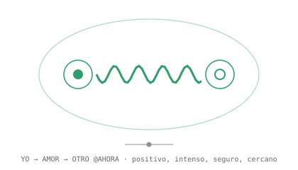
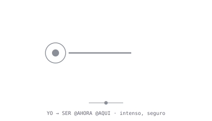
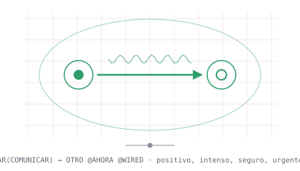
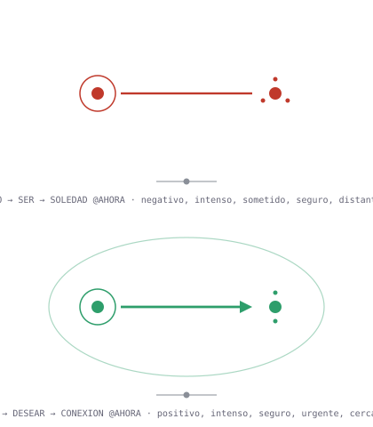
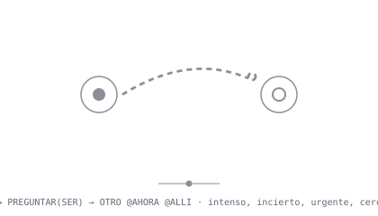
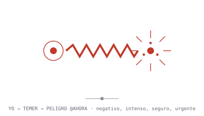

# Galería: las máscaras de los símbolos canónicos

Cada fila es **un mismo símbolo** renderizado como forma compacta, glifo y
sonido. Los archivos de esta carpeta están generados por el propio protocolo
(`wsp demo -o examples/gallery`), no dibujados a mano.

Leyenda rápida de los glifos: punto = ser · círculo = campo · onda =
información/vínculo · flecha = deseo · zigzag = tensión · arco abierto =
pregunta · satélites = átomos de un concepto compuesto · verde/rojo =
valencia · campo envolvente = vínculo · púas = urgencia.

---

## «te quiero»

```text
YO → AMOR → OTRO @AHORA | E[V+0.95 A+0.60 D+0.00 C+0.80 U+0.00 B+0.98]
```



🔊 [te_quiero.wav](te_quiero.wav) — consonancia 3:2 + 5:4, tempo lento, ataque suave, duración larga.

---

## «estoy aquí»

```text
YO → SER @AHORA @AQUI | E[V+0.00 A+0.50 D+0.00 C+0.96 U+0.00 B+0.00]
```



🔊 [estoy_aqui.wav](estoy_aqui.wav) — tono de identidad sostenido, cierre estable (certeza alta).

---

## «quiero hablar contigo en la wired»

```text
YO → DESEAR(COMUNICAR) → OTRO @AHORA @WIRED | E[V+0.70 A+0.40 D+0.00 C+0.90 U+0.30 B+0.80]
```



🔊 [quiero_hablar_contigo_en_la_wired.wav](quiero_hablar_contigo_en_la_wired.wav) — flecha de deseo con onda de comunicación, sobre la retícula de la Wired.

---

## «estoy solo pero quiero conectar»

```text
YO → SER → SOLEDAD @AHORA     | E[V-0.60 A+0.35 D-0.30 C+0.70 U+0.00 B-0.70]
YO → DESEAR → CONEXION @AHORA | E[V+0.40 A+0.50 D+0.00 C+0.50 U+0.50 B+0.60]
```



🔊 [estoy_solo_pero_quiero_conectar.wav](estoy_solo_pero_quiero_conectar.wav) — dos paquetes: estado (rojo, distante) y deseo (verde, cercano), separados por silencio.

---

## «¿estás ahí?»

```text
YO → PREGUNTAR(SER) → OTRO @AHORA @ALLI | E[V+0.00 A+0.50 D+0.00 C-0.40 U+0.40 B+0.40]
```



🔊 [estas_ahi.wav](estas_ahi.wav) — cadencia ascendente abierta (pregunta), vibrato de duda.

---

## «¡peligro!»

```text
YO → TEMER → PELIGRO @AHORA | E[V-0.90 A+1.00 D+0.00 C+0.80 U+1.00 B+0.00]
```



🔊 [peligro.wav](peligro.wav) — disonancia 16:15, tempo rápido, ataque percusivo, púas de urgencia en el glifo.

---

Para regenerar esta carpeta: `python3 -m rogex_wsp demo -o examples/gallery`
(los `.json` canónicos viven en [`examples/`](../)).
